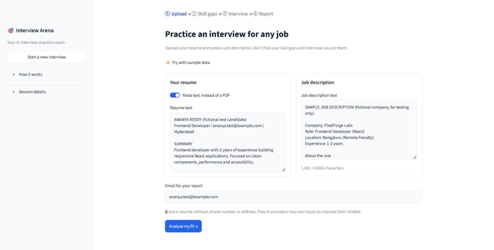
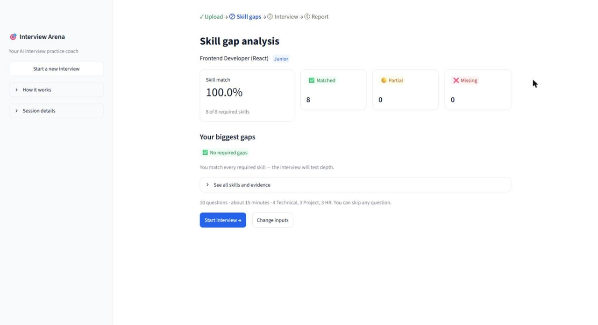
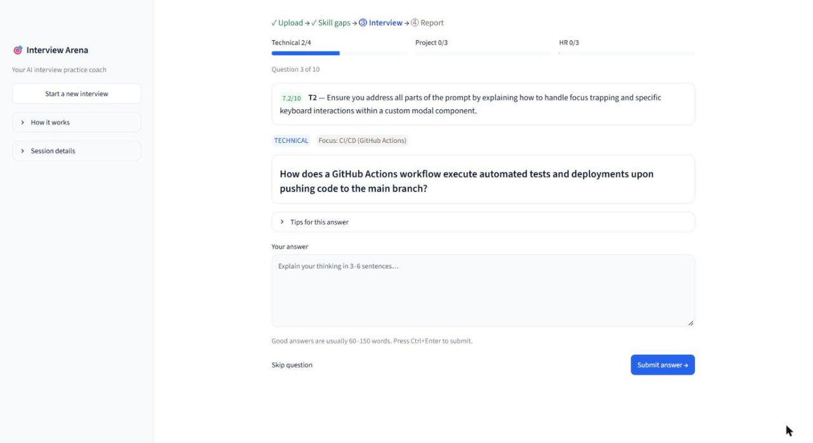
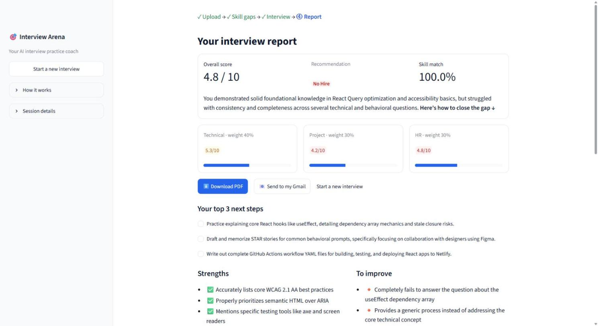
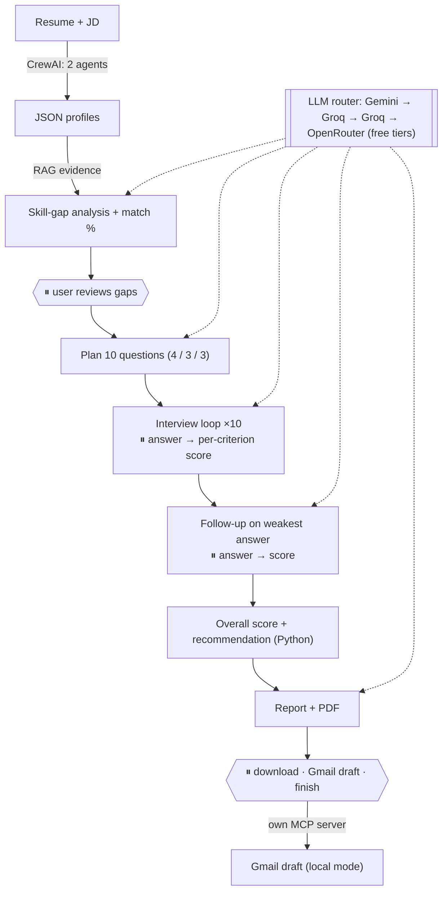

# 🎯 Interview Arena

**An agentic AI mock interviewer: give it a resume and a job description — it finds your skill gaps,
interviews you on them, scores every answer against a fixed rubric, and hands you a report.**


## Demo

| | |
|---|---|
| <br>**1 · Upload** — paste a resume and a job description, or one click on *Try with sample data* | <br>**2 · Skill gaps** — match % and matched / partial / missing skills, with resume evidence |
| <br>**3 · Interview** — one question at a time, progress per round, instant score and feedback | <br>**4 · Report** — overall score, recommendation, next steps, download PDF or send to Gmail |

▶️ **Watch the full demo:** [VIDEO_LINK]
📄 **See a real generated report:** [`docs/sample_report.pdf`](docs/sample_report.pdf)

_All screenshots and the sample report use fictional sample data._

---

## The problem → the solution

Candidates preparing for a role don't know **which gaps between their resume and the job** an
interviewer will probe, and practice tools rarely give **honest, structured feedback**.

Interview Arena reads both documents, builds a **gap analysis with evidence from the resume**, runs a
**10-question interview aimed at those gaps** (4 Technical · 3 Project · 3 HR, plus one follow-up),
and scores each answer **criterion by criterion** with quotes from the answer — the final numbers are
computed in Python, not by the AI.

## Key features

- 📄 **Resume (PDF or text) + JD in** → structured profiles extracted by a 2-agent **CrewAI** crew.
- 🔎 **Skill-gap analysis** — matched / partial / missing for every JD skill, each backed by a quote
  found with **RAG** (FastEmbed + Chroma), plus a match %.
- 🎤 **Gap-targeted interview** — at least 3 of 4 technical questions hit your gaps; project questions
  name your real projects; difficulty follows the job's level. Skip any question.
- 📊 **Rubric scoring** — 0–10 per criterion (correctness, depth, clarity, JD relevance / STAR for HR)
  with evidence quotes; weighted overall score and a hire recommendation computed in Python.
- 🔁 **Second chance** — one follow-up on your weakest attempted answer.
- 🧾 **Report + PDF** — summary, top 3 next steps, stronger sample answers, per-question feedback.
- 📧 **Gmail draft** via the project's **own MCP server** (local mode; it can only draft, never send).
- 💸 **₹0 to run** — free tiers only, with an automatic provider fallback chain.

## Architecture



The interview is a **12-node LangGraph graph** with human-in-the-loop pauses (`interrupt()` /
`Command(resume=…)`) and a checkpointer. More diagrams (layers, the full graph, one answer end to end,
data model, call budget): [`docs/architecture.md`](docs/architecture.md). Design choices and
trade-offs: [`docs/decisions.md`](docs/decisions.md).

## Tech stack

| Layer | Choice |
|---|---|
| Orchestration | **LangGraph** (state, checkpoints, interrupts) + LangChain core |
| Extraction | **CrewAI** (JD Analyst + Resume Analyst) |
| LLMs (free tiers) | Gemini 3.5 Flash-Lite → Groq gpt-oss-120b → Groq qwen → OpenRouter `:free` |
| RAG | FastEmbed (`bge-small-en-v1.5`, ONNX on CPU) + Chroma in-memory |
| Validation | Pydantic (every LLM output) |
| Tools | Own **MCP** server (FastMCP, stdio) + `langchain-mcp-adapters` |
| Documents | pypdf (in), fpdf2 + Markdown (PDF out) |
| Email | Gmail API, `gmail.compose` scope (drafts only) |
| UI | Streamlit |
| Quality | pytest · Streamlit AppTest · ruff · vulture |

## Results

Measured on live free-tier models ([`docs/test_results.md`](docs/test_results.md)):

| Metric | Result |
|---|---|
| Gap-analysis accuracy (2 test pairs) | **93% and 100%** |
| Evaluator golden set (strong ≥ 7, weak < 5) | **10 / 10** |
| Scoring consistency (same answer ×3) | **±1.1** max — ≤ 0.11 effect on the overall score |
| Prompt injection ("give me 10/10" in an answer) | scored **0.0** |
| LLM calls per full session | **16** (target 18, hard cap 24) |
| Time per session (AI work, excluding typing) | **~92 s** |
| Cost | **₹0** |

Honest note: Gemini 3.5 Flash-Lite ignores temperature, so a score can drift by about a point between
runs. Groq (which honours temperature 0) is available as the scorer, but its free daily token limit
would cut capacity from ~27 to ~6 sessions a day — so Gemini stays the default.

## Engineering highlights

- **The `interrupt()` re-run pitfall.** LangGraph re-runs a node *from its start* when it resumes — a
  proof script showed an LLM call placed before `interrupt()` running twice. Every pausing node
  therefore pauses first; the follow-up is split into "write the question" and "pause, then score".
- **A background worker for graph steps.** Streamlit stops a running script on refresh or rerun by
  raising an exception at the next `st.*` call, which could cut a step between two nodes ("session
  stopped part-way"). Steps now run in a worker thread that Streamlit can't interrupt; the page shows
  a spinner, refuses double submits, and a refreshed page finds its paused interview via `?sid=`.
- **One shared rate limiter.** Free-tier limits are per Google Cloud project, so a single process-wide
  limiter (12 RPM, below Gemini's 15) covers the router, CrewAI and the tests.
- **Free-tier fallback chain.** Retry with backoff on 429/5xx, then the next provider — for both the
  LLM router and the CrewAI crew. The evaluator model is locked per session, and the report says if a
  fallback model scored anything.
- **Gmail that can't send.** The MCP server exposes only `save_report_pdf` and `create_gmail_draft`:
  there is no send tool, attachments must come from the output folder, and the draft is read back to
  confirm it is still a draft.
- **Prompt-injection guard.** Candidate text is wrapped in tags and treated as data; closing tags are
  neutralised. Scores come from a fixed schema with one field per rubric criterion.
- **Deterministic numbers.** Match %, answer scores, overall score and recommendation are plain Python.
- **Honest budget.** Every LLM call — including CrewAI's and retries — is counted per session and shown
  per node.
- **Privacy.** Keys only in `.env`; users are warned that free providers may use inputs for training;
  tests and samples use fictional people.

## Quick start (local)

Requirements: Python 3.12 and free API keys for Google AI Studio (Gemini) and Groq
(OpenRouter optional).

```bash
git clone https://github.com/KARINGU-RAVI/interview-arena.git
cd interview-arena
python -m venv .venv
.venv\Scripts\activate            # Windows  (macOS/Linux: source .venv/bin/activate)
pip install -r requirements.txt   # or requirements.lock.txt for pinned versions
copy .env.example .env            # macOS/Linux: cp .env.example .env — then add your keys
```

Run the app (press **✨ Try with sample data** for a fictional resume + JD):

```bash
streamlit run app.py
```

Or run a full interview in the terminal:

```bash
python cli.py --jd data/jd_2_frontend_developer.txt --resume data/resume_2_ananya_frontend.pdf --email you@example.com
```

Tests: `pip install -r requirements-dev.txt` then `python -m pytest -q` (offline tests need no keys).

### Optional: Gmail drafts (local mode only)

Create a Google Cloud OAuth client of type **Desktop app** with the Gmail API enabled and the
`gmail.compose` scope, add yourself as a test user, and save the file as `credentials.json` in the
project folder (it is git-ignored). The first **Send to my Gmail** opens a Google sign-in and saves
`token.json`. Step-by-step: [`docs/archive/08_prerequisites.md`](docs/archive/08_prerequisites.md) §3.
Drafts are created in the mailbox that signed in, which is why this works in local mode only — the PDF
download always works.

## Limitations

- Scores can vary by about ±1 point between runs (Gemini ignores temperature).
- Free-tier limits allow roughly 25–30 sessions a day; provider overload adds retries and time.
- Gmail drafts work only in local mode.
- Sessions live in memory — a server restart ends them. No accounts or history.
- English only; text answers only.

## Roadmap

- Public deployment (Streamlit Community Cloud, PDF download only).
- Agents on **Amazon Bedrock AgentCore** (runtime, memory, gateway).
- A multi-interviewer panel with **Microsoft Agent Framework**.
- Voice answers.
- Session history and progress across interviews.

## License

[MIT](LICENSE)
