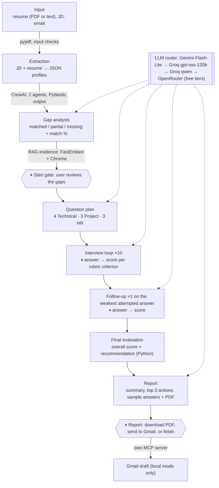
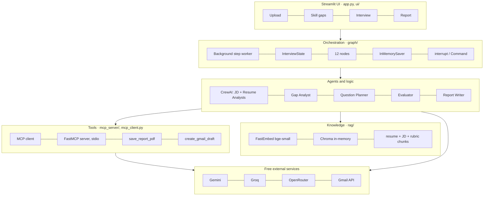
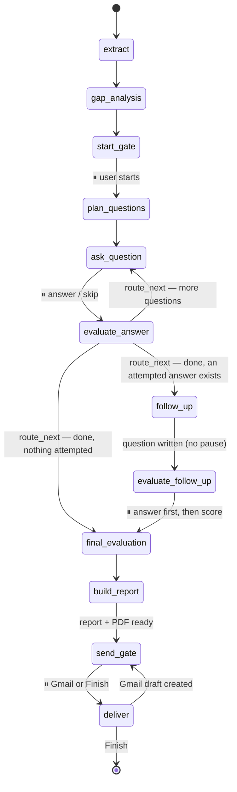

# Architecture

Interview Arena reads a resume and a job description, finds the skill gaps, runs a 10-question
interview focused on them, scores every answer with a fixed rubric, and produces a report + PDF
(optionally a Gmail draft). Diagrams are Mermaid (they render on GitHub).

## 1. Data flow



## 2. Layers



## 3. The LangGraph graph (12 nodes)



Rules that shape the graph:

- **No LLM call before `interrupt()` in a node.** LangGraph re-runs a node from its start when it
  resumes, so a call placed before the pause would run twice. `follow_up` only writes the question;
  `evaluate_follow_up` pauses first and scores after.
- `route_next` is a conditional **edge** (a function), not a node.
- The state holds plain data only, so `InMemorySaver` can checkpoint it at every pause. Live objects
  (LLM router, RAG store) are passed as LangGraph runtime **context** on every invoke.

## 4. One answer, end to end

```mermaid
sequenceDiagram
    actor U as User
    participant UI as Streamlit page
    participant W as Step worker (thread)
    participant G as LangGraph
    participant R as LLM router
    U->>UI: Submit answer
    UI->>W: submit(Command(resume=answer)) — refused if a step is running
    UI-->>U: spinner (page waits; refresh/rerun can't cancel the step)
    W->>G: stream(Command, thread_id, context)
    G->>R: evaluate_answer → per-criterion scores (1 call)
    R-->>G: validated JSON (Pydantic)
    G-->>W: paused at the next question (checkpointed)
    UI->>G: get_state → pending interrupt
    UI-->>U: result card + next question
```

**Why a background worker:** Streamlit stops a running script on refresh or rerun by raising an
exception at the next `st.*` call. Running the graph inside the script let that cut a step between two
nodes. In a worker thread the step always finishes at a clean, checkpointed pause; the page only waits
and redraws. A session id in the URL (`?sid=`) lets a refreshed page find its paused interview.

## 5. Data model

```mermaid
classDiagram
    class InterviewState {
      resume_text, jd_text, candidate_email
      jd_profile, resume_profile
      gaps, match_percent
      questions, current_index, answers, evaluations
      follow_up, overall
      report_summary, report_markdown, report_path
      delivery, send_action, finished, llm_calls
    }
    class JDProfile { role_title; level; required_skills; nice_to_have; responsibilities }
    class ResumeProfile { name; skills; tools; years_experience; projects; education; certifications }
    class GapItem { skill; importance; status; evidence }
    class Question { id; round; text; target_skill }
    class QuestionPlan { questions: exactly 4 / 3 / 3 }
    class Evaluation { question_id; round; score; criteria; strengths; weaknesses; feedback; skipped; error }
    class ReportSummary { summary; top_actions (3); sample_answers }
```



## 6. LLM call budget per session

| Step | Calls |
|---|---|
| extract (CrewAI, 2 agents) | 2 |
| gap_analysis | 1 |
| plan_questions (+1 retry if a rule is broken) | 1 |
| evaluate_answer ×10 (skips and "don't know" cost 0) | ≤ 10 |
| follow_up + evaluate_follow_up | 2 |
| final_evaluation (Python only) | 0 |
| build_report (one batched Report Writer call) | 1 |
| **Total** | **≤ 17** (target 18, hard cap 24) |

Gemini is limited to 12 requests/minute by one process-wide limiter (shared by CrewAI, the router
and tests). Every call goes through `llm/router.py` except CrewAI's two, which are added to the same
per-session count.
